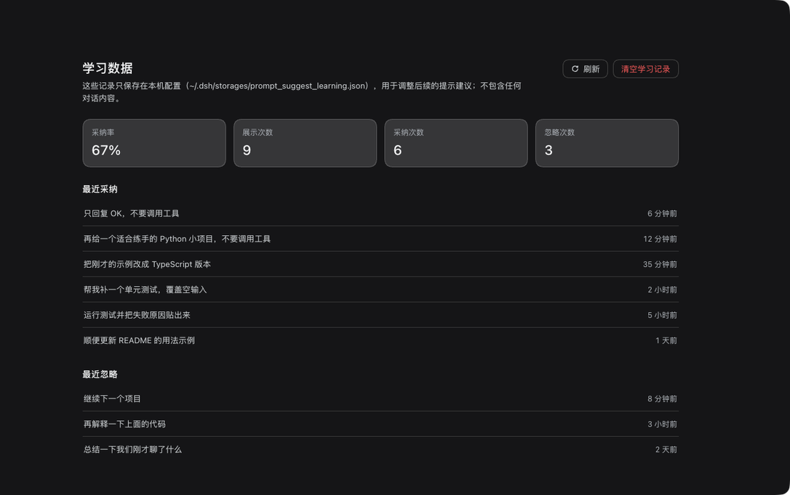
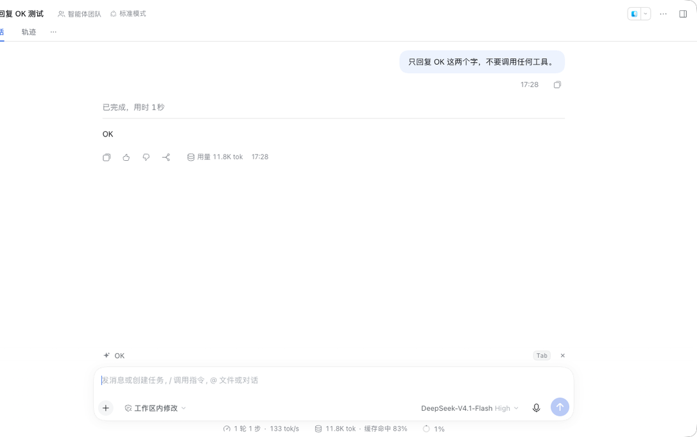

# dsh-prompt-suggest

Next-prompt suggestions for the [DeepSeek Harness](https://github.com/deepseek-ai/deepseek-harness) Web composer:
after each assistant reply, when the composer is empty and idle, a predicted **next user message** appears
above the input. Press **Tab** to insert it into the composer — it is never sent automatically. The plugin
also records accept/dismiss actions and uses them to condition later suggestions, and exposes the stored
learning data on a **Learning data** page in the left sidebar.

Inspired by the interaction model of OpenAI Codex "Composer predictions"; this is an independent
implementation for DSH, not copied code. It is one of several community implementations: see
[Prior art and the DSH next-prompt ecosystem](https://github.com/lazyfoxy33-dev/dsh-prompt-suggest/blob/main/docs/ECOSYSTEM.md) for alternatives, distribution, and
trade-offs.



*Screenshots use sample learning data; the counts are illustrative, not measured accuracy.*

## Features

- One predicted next prompt after every completed assistant turn; no suggestion when nothing is likely.
- **Tab** (or click) inserts the suggestion into the composer without sending; **✕** dismisses it.
- Hidden while typing, while the session runs, or while attachments are pending; other `Tab` behavior
  (focus traversal, slash-command completion, …) is untouched.
- **Learns from you**: shown / accepted / dismissed suggestions are counted and the accepted/dismissed
  examples condition the next prediction; dismissed suggestions (and close variants) are filtered out.
  `Shift+click ✕` clears the learned record.
- **Learning data page** in the sidebar: acceptance rate, shown/accepted/dismissed counts, recent accepted
  and dismissed suggestions with relative times, refresh, and a two-step "Clear learning record" action.
- Localized (zh/en/ja/es/fr/de/ru/pt), follows the host theme, light and dark.



## Compatibility

- DSH `>=0.2.2-rc.1 <0.3.0` (declared as `engines.dsh` in `package.json`).
- Web surface (desktop app or Web profile). The Host half is dependency-free ESM; the browser half is a
  plain `window.__ModuleLoader__` module that only requires `react`.

## Install

This project is **not published to npm**. It is a DSH **bundle** (`dsh.bundle.patch`), so it installs
straight from GitHub:

- **Desktop app**: open **Plugins**, install a bundle, and use the spec
  `github:lazyfoxy33-dev/dsh-prompt-suggest#v1.0.0`.
- **CLI**: `dsh plugin --profile <profile> add github:lazyfoxy33-dev/dsh-prompt-suggest#v1.0.0`

Pin a tag or commit for a reproducible install; `main` can move. The package is plain JavaScript and has
**no install scripts**, so no build allowlist (`allowBuilds`) is needed. After installing, enable the
**Next prompt suggestions** bundle/row if it is not enabled already, then reload the page once.

Uninstall by removing the `dsh-prompt-suggest` bundle in the Plugin Manager, or
`dsh plugin --profile <profile> remove dsh-prompt-suggest`.


## Discover

This repository publishes its own DSH plugin-market index (format 1):

```
https://lazyfoxy33-dev.github.io/dsh-prompt-suggest/index.json
```

In DSH open **Plugins → Discover → Add index source**, paste that URL, then install
**Next prompt suggestions** from the card. The index pins `1.0.0` to a tagged Git commit.

## Usage

1. Wait for the assistant to finish a turn.
2. Keep the composer empty and idle: the suggestion appears above the input, with a `Tab` keycap.
3. Press **Tab** to accept (the text is inserted for review/editing, not sent), or click the row.
4. Press **✕** to ignore one suggestion; `Shift+click ✕` clears all learned data.
5. Open **Learning data** in the sidebar to inspect or clear the record.

## Learning and data

- Signals: a suggestion shown (`shown`, once per turn), accepted (`accept`), dismissed (`dismiss`), and
  `reset` (clear). Feedback is sent fire-and-forget to the Host.
- The Host persists only bounded **suggestion texts and counters** — never conversation text — through
  DSH's `storageDomain` (`prompt_suggest_learning`, single JSON document) at
  `~/.dsh/storages/prompt_suggest_learning.json`. It survives reloads, restarts, and multiple clients.
- Later predictions include an acceptance rate, recent accepted examples (style/length/language hints), and
  recent dismissed examples (do not repeat). A candidate matching a dismissed suggestion is dropped.
- Caps: 12 examples per list, 200 chars per stored example, 50 dedupe keys. Defaults can be changed with
  `maxLearningExamples`, `maxLearningChars`; `learningEnabled: false` disables learning while keeping the
  stored record intact. The record is cleared from the Learning data page or with `Shift+click ✕`.

## Configuration

Override the bundle row in the profile's `cordis.patch.yml` (a patch replaces the row's whole `config`):

```yaml
- id: prompt-suggest
  name: 'dsh-prompt-suggest'
  config:
    enabled: true
    provider: ''            # empty = use the session's last model route
    model: ''
    maxSuggestionChars: 96
    contextMessages: 10
    maxToolEntries: 6
    messageTextLimit: 480
    maxPromptChars: 8000
    maxTokens: 256
    temperature: null       # null = do not send temperature
    timeoutMs: 20000
    cacheTtlMs: 600000
    cacheMaxEntries: 32
    reasoningEffort: ''     # empty = model's least reasoning effort
    semanticCheck: true
    learningEnabled: true
    maxLearningExamples: 8
    maxLearningChars: 160
```

## Privacy

- Prediction requests go to the model provider selected for the session (or pinned in `provider`/`model`
  configuration), and never write to the session log. A request includes recent conversation context plus
  bounded accepted/dismissed examples; when steps have completed, a short semantic redundancy check sends
  the candidate and those step summaries to the same provider. That content leaves the machine under the
  model provider's terms.
- The Host logs nothing and runs no plugin-operated server, telemetry, or analytics. It persists only local
  learning data (suggestion texts + counters), at `~/.dsh/storages/prompt_suggest_learning.json`.
- Learning data lives in the local DSH profile; clearing it is a click away.
- Learning conditions the prompt; it is not model training or fine-tuning, and it does not guarantee
  prediction accuracy.

## Scope and limitations

- One suggestion per completed turn. There is no candidate cycling, manual "suggest again", word-by-word
  acceptance, or Up/Down prompt history.
- Tab or click fills the draft; there is no Enter-to-send path.
- Web surface only.
- It binds `Tab` in the composer and cannot coexist with another plugin that also binds Tab for
  suggestions. See the compatibility notes in [ECOSYSTEM.md](https://github.com/lazyfoxy33-dev/dsh-prompt-suggest/blob/main/docs/ECOSYSTEM.md).

## Development

```sh
node --test test/host.test.mjs   # host unit tests (prompt pipeline, learning store, routes, privacy)
```

Repository layout:

| Path | Purpose |
|---|---|
| `index.js` | Host half: suggestion route, feedback route, learning-data route, durable learning store |
| `client.js` | Browser half: composer suggestion row, Tab handling, feedback signals, Learning data page and sidebar icon |
| `cordis.patch.yml` | Bundle patch inserting the `prompt-suggest` row |
| `locale/` | Plugin Manager display metadata (`meta.title`, `meta.description`) |
| `docs/DESIGN.md` | Implementation contract and design notes |
| `docs/ECOSYSTEM.md` | Prior art: similar DSH plugins, differences, compatibility |
| `docs/*.png` | Screenshots used by this README |

The Host half has no imports; the browser half uses only the module-table `react` export, so there is no
build step.

## License

MIT — see [LICENSE](https://github.com/lazyfoxy33-dev/dsh-prompt-suggest/blob/main/LICENSE).
