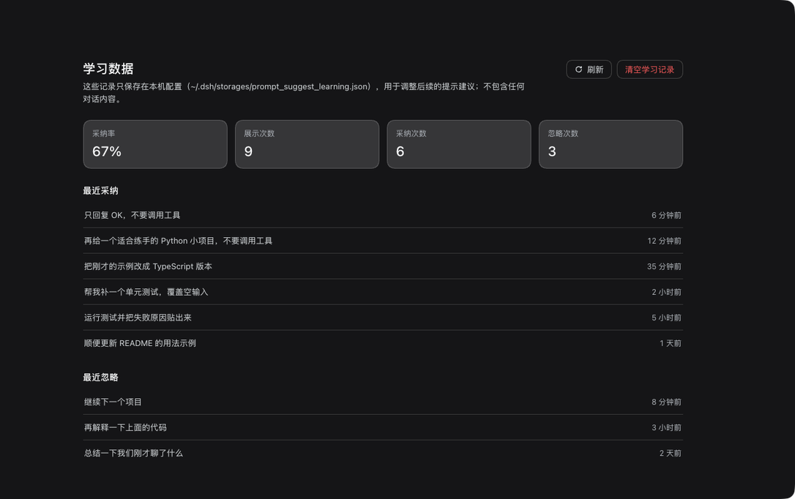
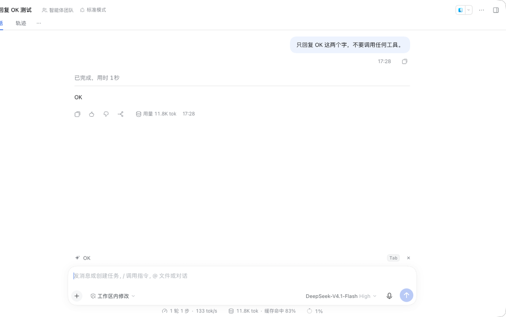

# dsh-prompt-suggest

给 [DeepSeek Harness](https://github.com/deepseek-ai/deepseek-harness) Web 输入框加上"下一步提示建议"：
助手每完成一轮回复、且输入框为空并空闲时，输入框上方会出现一句根据当前会话预测的**下一句用户消息**；
按 **Tab** 即可填入输入框（不会自动发送）。插件还会记录采纳/忽略并据此调整后续建议，并在左侧栏提供
**学习数据**页面查看统计。

交互参考 OpenAI Codex 的 Composer predictions；本插件为独立的 DSH 实现，未复制其代码。
同类项目不止一个：差异、分发方式和兼容性见 [同类插件与生态](https://github.com/lazyfoxy33-dev/dsh-prompt-suggest/blob/main/docs/ECOSYSTEM.zh.md)。



*截图中使用示例学习数据，数字仅作展示，不代表真实预测准确率。*

## 功能

- 每轮助手回复结束后预测一条下一句提示；没有合适内容时不显示。
- 按 **Tab**（或点击整行）填入输入框但**不发送**；点 **✕** 忽略本次建议。
- 输入中、会话运行中、附件待发时自动隐藏；不会吞掉其他场景的 `Tab`（焦点切换、斜杠命令补全等）。
- **从使用中学习**：记录展示/采纳/忽略，采纳示例与忽略示例会条件化下一次预测；命中已忽略建议（或近似文本）
  的候选会被丢弃。`Shift+点击 ✕` 清空学习记录。
- **学习数据页**（左侧栏）：采纳率、展示/采纳/忽略次数、最近采纳与最近忽略建议（相对时间）、刷新、
  两步确认"清空学习记录"。
- 本地化（中/英/日/西/法/德/俄/葡），跟随宿主主题，支持深浅色。



## 兼容性

- DSH `>=0.2.2-rc.1 <0.3.0`（`package.json` 的 `engines.dsh`）。
- 面向 Web 界面（桌面应用或 Web profile）。Host 半为零依赖 ESM；浏览器半是普通
  `window.__ModuleLoader__` 模块，只使用模块表提供的 `react`。

## 安装

已发布到 npm：**`dsh-prompt-suggest`**。它同时是一个 DSH **bundle**（声明了 `dsh.bundle.patch`），
因此可以从 npm、GitHub 或 Discover 索引安装：

- **npm**：`dsh plugin --profile <profile> add dsh-prompt-suggest@1.0.0`
- **GitHub**：`dsh plugin --profile <profile> add github:lazyfoxy33-dev/dsh-prompt-suggest#v1.0.0`
- **桌面应用**：打开 **插件**，安装 bundle，填入上述任一 spec。

建议固定版本或 tag 以保证可复现。包是纯 JavaScript，**没有安装脚本**，因此不需要 `allowBuilds` 授权。
安装后在插件管理器中启用 **Next prompt suggestions** 行（若未启用），并刷新一次页面。

卸载：在插件管理器中移除 `dsh-prompt-suggest` bundle，或
`dsh plugin --profile <profile> remove dsh-prompt-suggest`。


## Discover 市场

本仓库自带一个 DSH 插件市场索引（format 1）：

```
https://lazyfoxy33-dev.github.io/dsh-prompt-suggest/index.json
```

在 DSH 中打开 **插件 → Discover → 添加索引来源**，粘贴该 URL，即可在卡片中安装
**Next prompt suggestions**。索引把 `1.0.0` 固定到打 tag 的 Git commit。

## 使用

1. 等助手完成一轮回复；
2. 保持输入框为空、会话空闲，建议行会出现在输入框上方（带 `Tab` 键帽）；
3. 按 **Tab** 采用（文本进入输入框，可继续编辑，不会发送），或点击整行；
4. 按 **✕** 忽略本次建议；`Shift+点击 ✕` 清空全部学习记录；
5. 打开左侧栏 **学习数据** 查看或清空记录。

## 学习机制与数据

- 信号：建议展示（`shown`，每轮一次）、采纳（`accept`）、忽略（`dismiss`）、清空（`reset`），
  以 fire-and-forget 方式发给 Host。
- Host 只持久化**建议文本和计数**（不含对话正文），通过 DSH 的 `storageDomain`
  （`prompt_suggest_learning` 单文档）保存在 `~/.dsh/storages/prompt_suggest_learning.json`；
  重启、换端口、多客户端共享同一份。
- 之后的预测会带上：采纳率、最近采纳示例（语言/长度/语气参考）、最近忽略示例（不要重复）；
  命中已忽略建议或近似的候选不显示。
- 上限：每类最近 12 条、单条 200 字符、50 个去重键。可通过 `maxLearningExamples`、`maxLearningChars`
  调整；`learningEnabled: false` 可关闭学习（保留记录）。清空入口：学习数据页，或 `Shift+点击 ✕`。

## 配置

在 profile 的 `cordis.patch.yml` 中覆盖该行（patch 会替换整段 config）：

```yaml
- id: prompt-suggest
  name: 'dsh-prompt-suggest'
  config:
    enabled: true
    provider: ''            # 留空 = 跟随会话最近一次请求的模型
    model: ''
    maxSuggestionChars: 96
    contextMessages: 10
    maxToolEntries: 6
    messageTextLimit: 480
    maxPromptChars: 8000
    maxTokens: 256
    temperature: null       # null = 不传 temperature
    timeoutMs: 20000
    cacheTtlMs: 600000
    cacheMaxEntries: 32
    reasoningEffort: ''     # 留空 = 使用模型最低推理档
    learningEnabled: true
    maxLearningExamples: 8
    maxLearningChars: 160
```

## 隐私

- 预测请求发往该会话选择的模型提供商（或在配置中固定的 `provider`/`model`），且不写入会话日志。
  请求会带上最近的对话上下文和有限的采纳/忽略示例，因此这部分内容会按模型提供商的服务条款离开本机。
- Host 不写日志，不运行插件自带的服务器，无遥测、无分析；只在本机持久化学习数据（建议文本 + 计数），
  位于 `~/.dsh/storages/prompt_suggest_learning.json`。
- 学习数据存在本机 DSH profile 中，可随时一键清空。
- 学习只会条件化提示词，不是训练模型或微调权重，也不保证预测准确率。

## 范围与限制

- 每轮只给一条建议；没有候选项切换、手动“再建议一次”、逐词采纳、↑/↓ 历史回滚。
- 以 Tab 或点击填入草稿；没有 Enter 直接发送路径。
- 仅 Web 界面。
- 占用输入框的 `Tab`，不能与另一个同样占用 Tab 的建议插件共存；兼容性说明见
  [ECOSYSTEM.zh.md](https://github.com/lazyfoxy33-dev/dsh-prompt-suggest/blob/main/docs/ECOSYSTEM.zh.md)。

## 开发

```sh
node --test test/host.test.mjs   # Host 单测（提示词、学习存储、路由、隐私等）
```

| 路径 | 说明 |
|---|---|
| `index.js` | Host 半：建议路由、反馈路由、学习数据路由、持久化学习存储 |
| `client.js` | 浏览器半：输入框上方建议行、Tab 处理、反馈信号、学习数据页与侧栏图标 |
| `cordis.patch.yml` | bundle 补丁，插入 `prompt-suggest` 行 |
| `locale/` | 插件管理器显示元数据（`meta.title` / `meta.description`） |
| `docs/DESIGN.md` | 实现契约与设计记录 |
| `docs/ECOSYSTEM.zh.md` | 同类插件、差异与兼容性 |
| `docs/*.png` | README 截图 |

Host 半无 import；浏览器半只使用模块表的 `react`，无需构建步骤。

## 许可证

MIT，见 [LICENSE](https://github.com/lazyfoxy33-dev/dsh-prompt-suggest/blob/main/LICENSE)。
